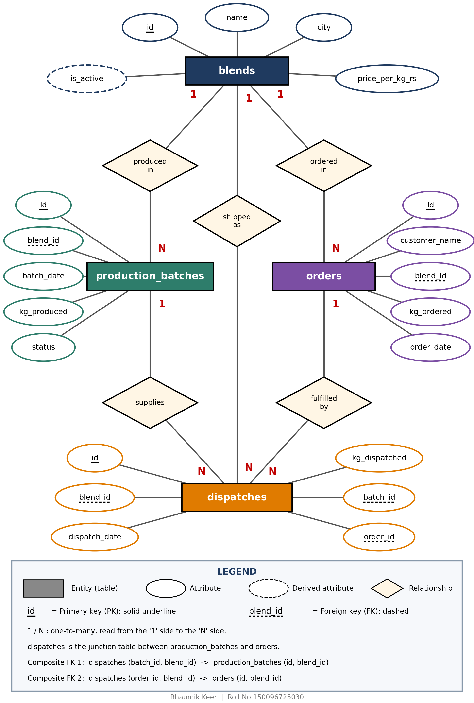

# Spice Grinding Unit Order Fulfilment Database (PostgreSQL)

**DBMS Case Study 131** | B.Tech CSE 2025-29, Semester III | ITM Skills University
**Author:** Bhaumik Keer

A PostgreSQL database for a spice grinding unit that takes bulk orders for ground spice blends, produces them in batches and dispatches them to retailers. The project focuses on **transactions, ACID properties and concurrency**.

## What it does

- Tracks **blends**, **production batches**, **customer orders** and **dispatches** in four related tables.
- Guarantees every dispatch points to **one blend, one completed batch and one real order**, all of the same blend (composite foreign keys).
- Stops stock from going negative and orders from being over-shipped, using a trigger with a row lock (`SELECT ... FOR UPDATE`).
- Keeps a derived `is_active` flag on blends correct with a second trigger.
- Demonstrates transactions (`BEGIN`, `COMMIT`, `ROLLBACK`, `SAVEPOINT`), a **lost update** and its fix, and the chosen isolation level.

## Database design



| Table | Purpose | Primary key | Foreign keys |
|---|---|---|---|
| `blends` | Master list of blends and price per kg | `id` | none |
| `production_batches` | One grinding run (source of stock) | `id` | `blend_id` -> blends |
| `orders` | Customer demand | `id` | `blend_id` -> blends |
| `dispatches` | Daily dispatch log, junction of batches and orders | `id` | `blend_id` -> blends, `(batch_id, blend_id)` -> production_batches, `(order_id, blend_id)` -> orders |

Design highlights: surrogate integer keys, `NUMERIC(8,2)` for money, `CHECK` constraints on quantities and prices, `ON DELETE RESTRICT`, indexes on foreign keys and dates, and a schema in 3NF (with `is_active` as a deliberate derived column).

## Triggers

- **`check_dispatch`** (before insert/update on `dispatches`): batch must be `COMPLETE`, dispatch date cannot be before the batch or order date, total dispatched can never exceed `kg_produced` or `kg_ordered`.
- **`refresh_is_active`** (after insert/update/delete on `dispatches`): keeps `blends.is_active` correct inside the same transaction.

## Dataset

12 blends, 18 production batches, 31 orders and 29 dispatches, including the sample rows from the case study.
(Sample dispatch 1 was moved from 2024-01-08 to 2024-01-15 because it was dated before its batch existed.)

## How to run

Requires PostgreSQL 16 or newer (tested with `psql` on macOS).

```bash
createdb spice_db
psql -d spice_db -f project.sql
```

`project.sql` drops and recreates the tables, loads the data and runs all 13 queries in order. The **one `ERROR` message in Q08 is intentional**: it is the "second insert fails" case that proves atomicity.

## Queries in `project.sql`

| Query | What it shows |
|---|---|
| Q01 | Transaction inserting a dispatch (`BEGIN ... COMMIT`) |
| Q02 | What `ROLLBACK` undoes |
| Q03 | Lost update on the same dispatch |
| Q04 | Fix for the lost update (`FOR UPDATE` + relative update) |
| Q05 | `SAVEPOINT` inside a multi-step transaction |
| Q06 | Isolation level (`READ COMMITTED`) for recording a dispatch |
| Q07 | New blend + first dispatch as one atomic unit |
| Q08 | The same unit when the second insert fails (rolls back everything) |
| Q09 | Derived `is_active` flag maintained by a trigger |
| Q10 | Filtering (`WHERE`, `BETWEEN`) |
| Q11 | Join of dispatches, blends and orders with rupee value |
| Q12 | `GROUP BY` / `HAVING` revenue report |
| Q13 | Correlated subquery |

## ACID evidence

| Property | Shown in |
|---|---|
| Atomicity | Q02, Q07, Q08 |
| Consistency | Q08, Q09 (constraints and triggers refuse bad data) |
| Isolation | Q03, Q04, Q06 |
| Durability | Q01 (committed data is written to the WAL) |

## Repository contents

```
project.sql        schema, triggers, seed data and all queries
er_diagram.png     ER diagram (PK solid underline, FK dashed underline)
screenshots/       terminal screenshots of every query
Bhaumik_Keer_150096725030_DBMS_Report.pdf    full report with explanations
```

## Tech

PostgreSQL, PL/pgSQL, psql
